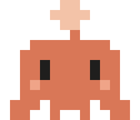

<div align="center">



# ClaudeHub

**See where your Claude Code tokens go.**

Local dashboard, desktop mascot, and context alerts. Windows, macOS, and Linux.

[Español](README.md) · **English** · [Português](README.pt-BR.md)

[](https://github.com/NormanSMA/ClaudeHub/actions/workflows/ci.yml)
[](https://github.com/NormanSMA/ClaudeHub/releases/latest)


<br />


<sub>Screenshots from demo mode: all data is fictional. The interface is in Spanish.</sub>

</div>

## What it does

- **Tokens and cost** by day, model, chat, and project.
- **Context** of each active chat, with an alert as it fills up.
- **Plan limits**: 5-hour and weekly, with a projection of when they run out.
- **Orchestrator vs subagents**: who spends what.
- **Other sources**: Codex, Gemini CLI, and OmniRoute.
- **Chispa**: a mascot in the corner or as an island on the top edge.

Everything runs on your machine. No data leaves it.

## Try it

Demo mode uses fictional data and reads nothing of yours.

```bash
git clone https://github.com/NormanSMA/ClaudeHub.git
cd ClaudeHub
pnpm install && pnpm build
pnpm demo
```

Open `http://127.0.0.1:4318`.

## Install

| System | How |
|---|---|
| **Windows** | Download `ClaudeHub-Setup-x.y.z.exe` from [Releases](https://github.com/NormanSMA/ClaudeHub/releases/latest). No Node needed. |
| **macOS and Linux** | From source, with Node 24 and pnpm 11: `pnpm install`, `pnpm build`, and `pnpm tray`. |
| **Browser** | Extension for [Chrome, Edge, Brave, and Firefox](extensions/README.md) and for [Safari](safari/README.md). |

> The installer is not signed. If SmartScreen warns you, click **More info** and **Run anyway**. To update, quit ClaudeHub with **Salir** (Quit) before installing.

## What you see

<table>
  <tr>
    <td></td>
    <td></td>
  </tr>
  <tr>
    <td align="center"><sub><b>Summary</b>: cost, cache, and activity</sub></td>
    <td align="center"><sub><b>Models</b>: tokens per day and API value</sub></td>
  </tr>
  <tr>
    <td></td>
    <td></td>
  </tr>
  <tr>
    <td align="center"><sub><b>Sessions</b>: which chats spend the most</sub></td>
    <td align="center"><sub><b>Island</b>: active chats from the top edge</sub></td>
  </tr>
</table>

## Chispa

Chispa changes state with your chats: it sleeps, thinks, uses tools, waits for a permission, or raises an alert. Choose its position in **Ajustes > Mascota** (Settings > Mascot):

- **Corner**: drag it around; one click opens the chat panel.
- **Top island**: shows chats, level, today's cost, and speed. It expands when you hover over it.

<p align="center"></p>

## Connect it to Claude Code

Everything is optional. Each step is in the [technical guide](docs/guia.md#integraciones-con-claude-code) (Spanish).

| You want | Use |
|---|---|
| Open ClaudeHub when Claude Code starts | `SessionStart` hook with `scripts/launch.cjs` |
| Real context and limits in the terminal | Status line `scripts/statusline.cjs` |
| Limits from the desktop app | `/uso` command |
| Each agent's state in Chispa | Hook `scripts/hook.cjs` |

<details>
<summary><b>Install with an AI</b></summary>

Paste this into Claude Code or another agent with terminal access:

````text
Install and run ClaudeHub: https://github.com/NormanSMA/ClaudeHub
1. Clone it and enter the folder.
2. Check Node 24+ and pnpm 11 with `node -v` and `pnpm -v`.
3. Run `pnpm install`, `pnpm build`, and `pnpm test`.
4. Try `pnpm demo` at http://127.0.0.1:4318 and stop it.
5. Run `pnpm tray` for the tray and the mascot.
6. Ask me before editing ~/.claude/settings.json. If I agree, add the SessionStart hook and the status line from docs/guia.md, with the real paths and without removing my settings.
7. Tell me my tokens for the last 7 days using /api/summary.
Read AGENTS.md for more details.
````

</details>

## Privacy

- The server listens only on `127.0.0.1`.
- It reads only usage fields and chat titles. Never responses.
- No telemetry. The only external request checks for new versions and can be turned off in **Ajustes** (Settings).

## Learn more

| Document | For |
|---|---|
| [Technical guide](docs/guia.md) (Spanish) | Configuration, API, hooks, calculations, and architecture. |
| [AGENTS.md](AGENTS.md) (Spanish) | AI agents that install or query ClaudeHub. |
| [CONTRIBUTING.md](CONTRIBUTING.md) | Contributing. Check with `npx tsc --noEmit && pnpm test && pnpm build`. |
| [SECURITY.md](SECURITY.md) | Reporting vulnerabilities. |

## License

[MIT](LICENSE) © 2026 Norman Smith Martínez Acevedo.
