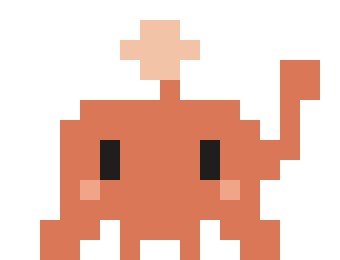
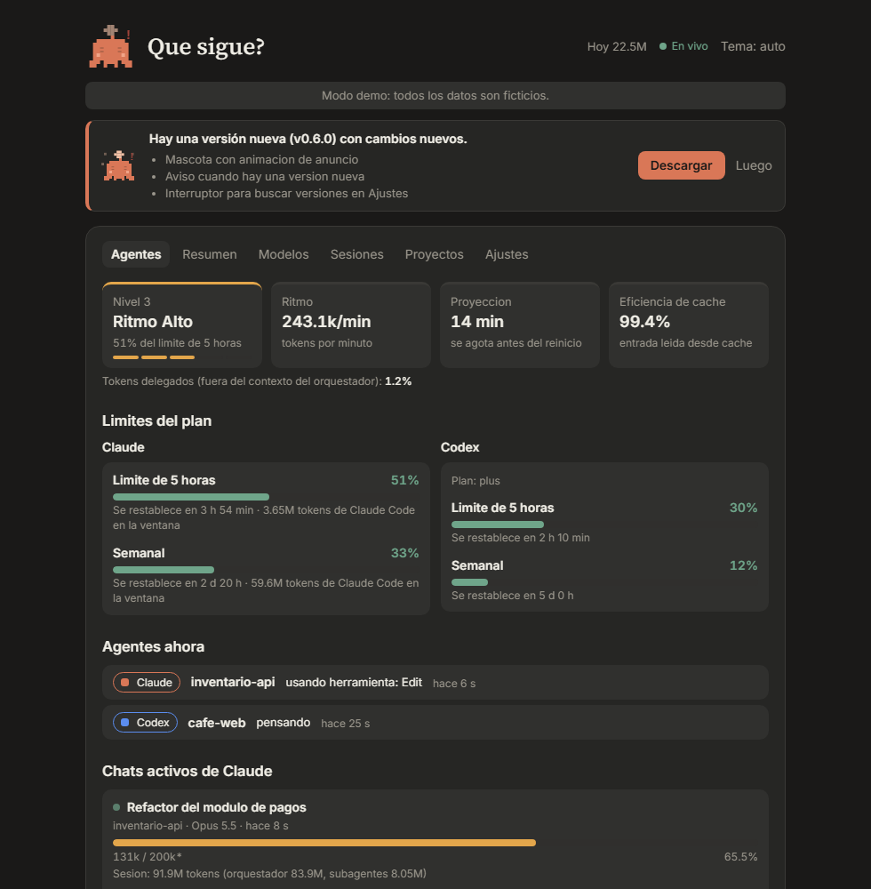
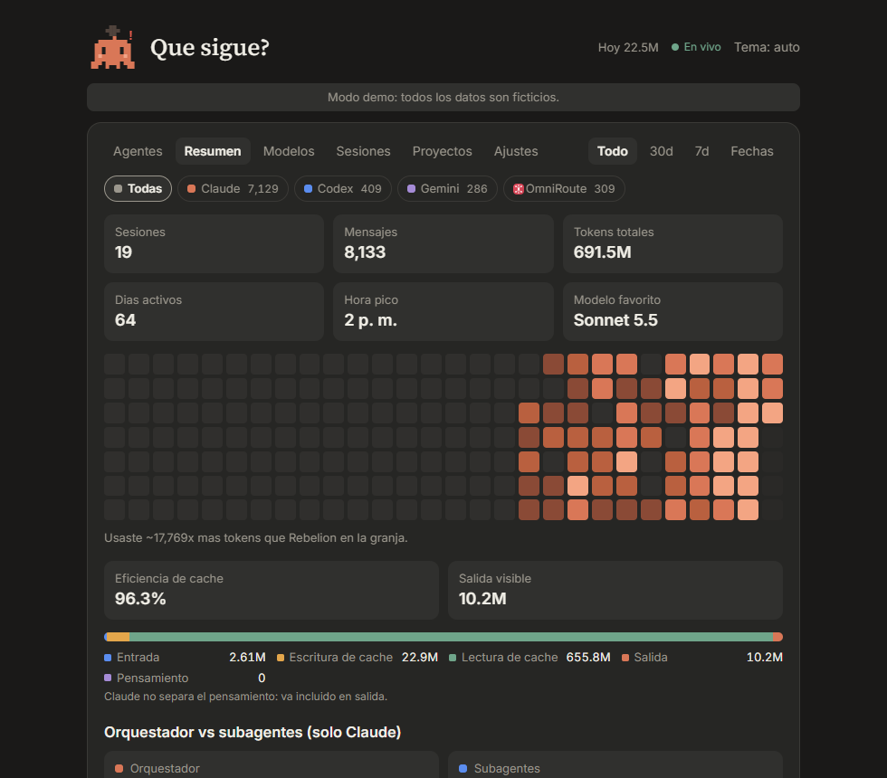
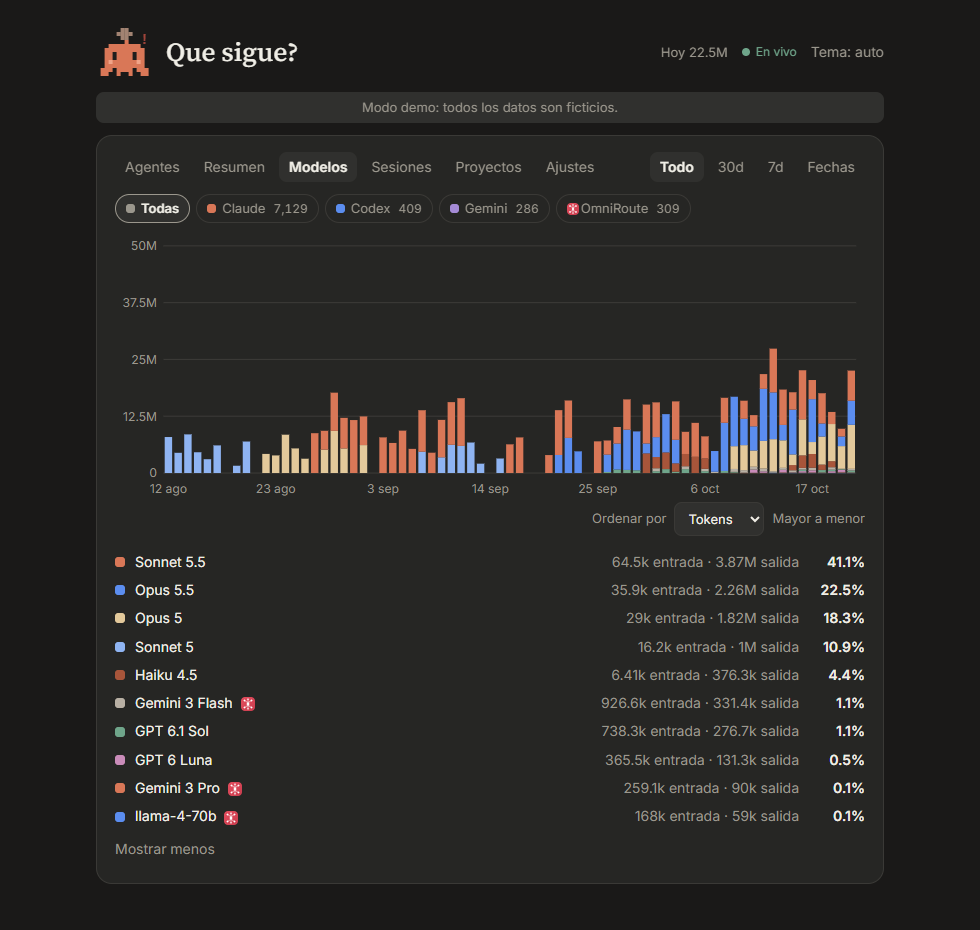
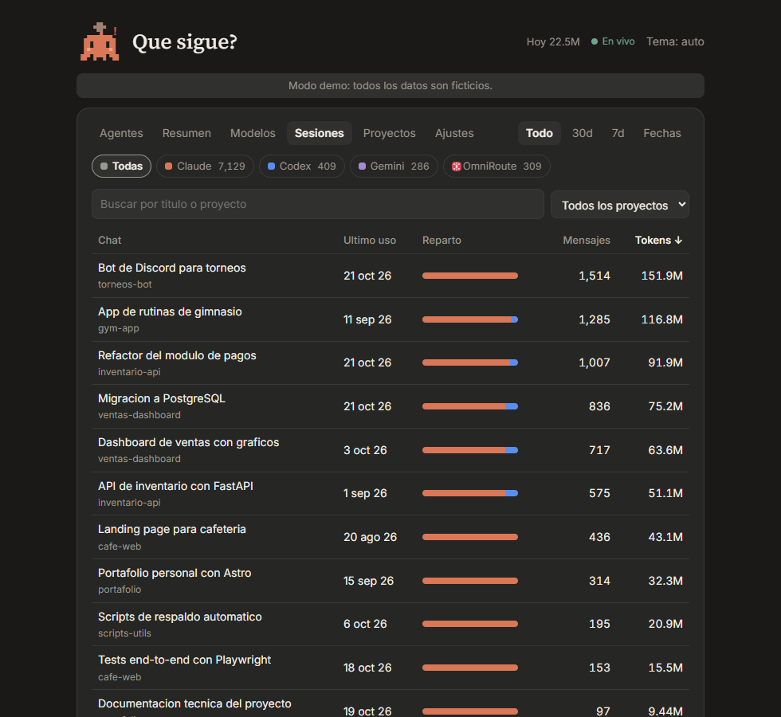
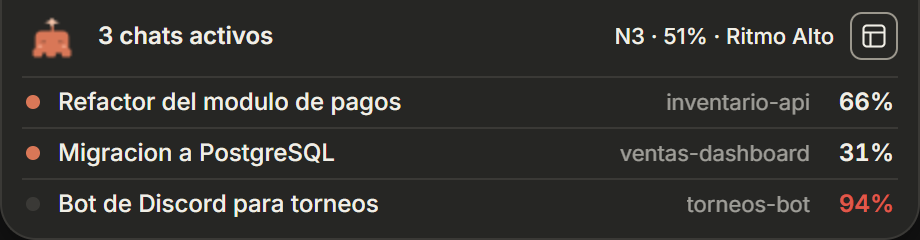
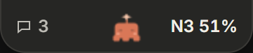

<div align="center">



# ClaudeHub

**Mira a dónde se van tus tokens de Claude Code.**

Dashboard local, mascota en el escritorio y alertas de contexto. Windows, macOS y Linux.

**Español** · [English](README.en.md) · [Português](README.pt-BR.md)

[](https://github.com/NormanSMA/ClaudeHub/actions/workflows/ci.yml)
[](https://github.com/NormanSMA/ClaudeHub/releases/latest)


<br />



<sub>Capturas del modo demo: todos los datos son ficticios.</sub>

</div>

## Qué hace

- **Tokens y costo** por día, modelo, chat y proyecto.
- **Contexto** de cada chat activo, con alerta al llenarse.
- **Límites del plan**: 5 horas y semanal, con proyección de cuándo se agotan.
- **Orquestador contra subagentes**: quién gasta qué.
- **Otras fuentes**: Codex, Gemini CLI y OmniRoute.
- **Chispa**: mascota en la esquina o como isla en el borde superior.

Todo corre en tu equipo. Ningún dato sale de él.

## Pruébalo

El modo demo usa datos ficticios y no lee nada tuyo.

```bash
git clone https://github.com/NormanSMA/ClaudeHub.git
cd ClaudeHub
pnpm install && pnpm build
pnpm demo
```

Abre `http://127.0.0.1:4318`.

## Instalar

| Sistema | Cómo |
|---|---|
| **Windows** | Descarga `ClaudeHub-Setup-x.y.z.exe` de [Releases](https://github.com/NormanSMA/ClaudeHub/releases/latest). No necesita Node. |
| **macOS y Linux** | Desde el código, con Node 24 y pnpm 11: `pnpm install`, `pnpm build` y `pnpm tray`. |
| **Navegador** | Extensión para [Chrome, Edge, Brave y Firefox](extensions/README.md) y para [Safari](safari/README.md). |

> El instalador no tiene firma. Si SmartScreen avisa, pulsa **Más información** y **Ejecutar de todos modos**. Para actualizar, cierra ClaudeHub con **Salir** antes de instalar.

## Lo que ves

<table>
  <tr>
    <td></td>
    <td></td>
  </tr>
  <tr>
    <td align="center"><sub><b>Resumen</b>: costo, caché y actividad</sub></td>
    <td align="center"><sub><b>Modelos</b>: tokens por día y valor API</sub></td>
  </tr>
  <tr>
    <td></td>
    <td></td>
  </tr>
  <tr>
    <td align="center"><sub><b>Sesiones</b>: qué chats gastan más</sub></td>
    <td align="center"><sub><b>Isla</b>: chats activos desde el borde superior</sub></td>
  </tr>
</table>

## Chispa

Chispa cambia de estado según tus chats: duerme, piensa, usa herramientas, espera un permiso o se alerta. Elige su posición en **Ajustes > Mascota**:

- **Esquina**: se arrastra y abre el panel de chats con un clic.
- **Isla superior**: muestra chats, nivel, costo de hoy y velocidad. Se expande al pasar el cursor.

<p align="center"></p>

## Conéctalo a Claude Code

Todo es opcional. Cada paso está en la [guía técnica](docs/guia.md#integraciones-con-claude-code).

| Quieres | Usa |
|---|---|
| Abrir ClaudeHub al iniciar Claude Code | Hook `SessionStart` con `scripts/launch.cjs` |
| Contexto real y límites en la terminal | Línea de estado `scripts/statusline.cjs` |
| Límites desde la app de escritorio | Comando `/uso` |
| Estados de cada agente en Chispa | Hook `scripts/hook.cjs` |

<details>
<summary><b>Instalar con una IA</b></summary>

Pega esto en Claude Code o en otro agente con acceso a tu terminal:

````text
Instala y ejecuta ClaudeHub: https://github.com/NormanSMA/ClaudeHub
1. Clónalo y entra en la carpeta.
2. Verifica Node 24+ y pnpm 11 con `node -v` y `pnpm -v`.
3. Ejecuta `pnpm install`, `pnpm build` y `pnpm test`.
4. Prueba `pnpm demo` en http://127.0.0.1:4318 y detenlo.
5. Ejecuta `pnpm tray` para la bandeja y la mascota.
6. Pregúntame antes de editar ~/.claude/settings.json. Si acepto, agrega el hook SessionStart y la línea de estado de docs/guia.md, con las rutas reales y sin borrar mis ajustes.
7. Dime mis tokens de los últimos 7 días con /api/summary.
Lee AGENTS.md para más detalles.
````

</details>

## Privacidad

- El servidor escucha solo en `127.0.0.1`.
- Solo lee campos de uso y títulos de chats. Nunca respuestas.
- Sin telemetría. La única consulta externa busca versiones nuevas y se apaga en **Ajustes**.

## Más información

| Documento | Para |
|---|---|
| [Guía técnica](docs/guia.md) | Configuración, API, hooks, cálculos y arquitectura. |
| [AGENTS.md](AGENTS.md) | Agentes de IA que instalan o consultan ClaudeHub. |
| [CONTRIBUTING.md](CONTRIBUTING.md) | Contribuir. Verifica con `npx tsc --noEmit && pnpm test && pnpm build`. |
| [SECURITY.md](SECURITY.md) | Reportar vulnerabilidades. |

## Colaboradores

<table>
  <tr>
    <td align="center"><a href="https://github.com/NormanSMA"><br /><sub><b>Norman Martínez</b></sub></a><br /><sub>Autor</sub></td>
    <td align="center"><a href="https://github.com/kisnner26"><br /><sub><b>Kisnner Obando</b></sub></a><br /><sub>Prueba en macOS y extensión de Safari</sub></td>
  </tr>
</table>

## Licencia

[MIT](LICENSE) © 2026 Norman Smith Martínez Acevedo.
