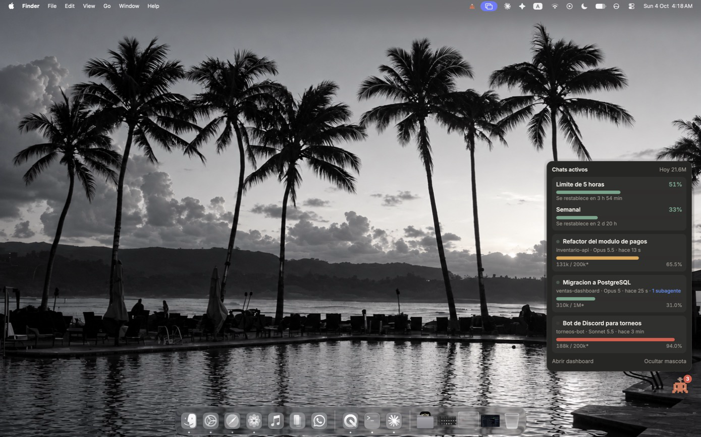
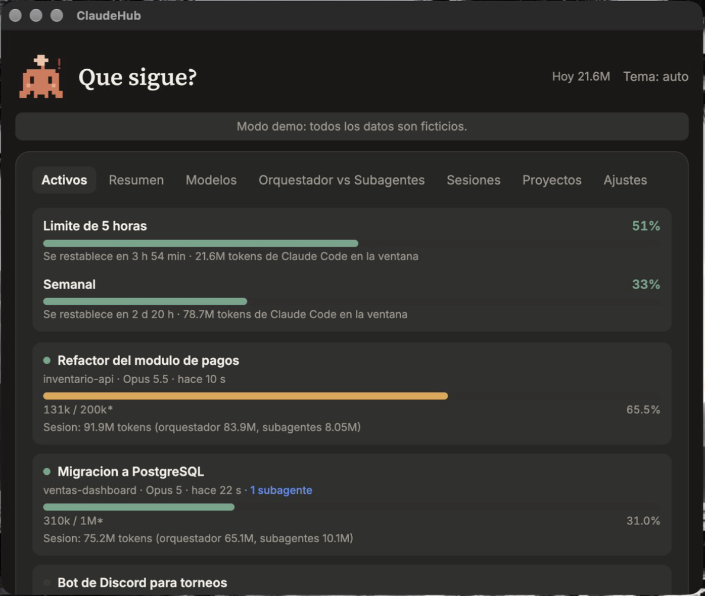
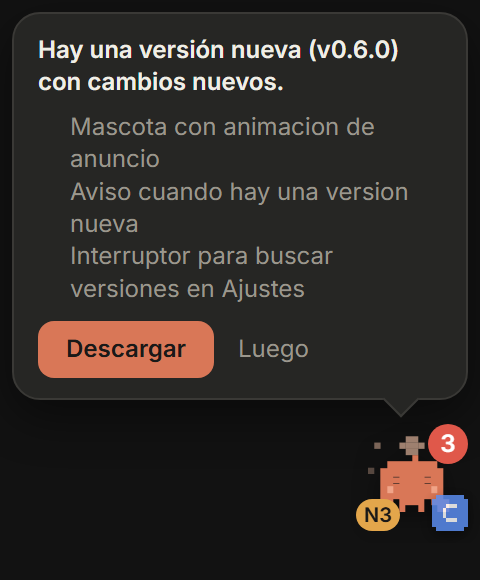

# Guía técnica de ClaudeHub

Referencia completa. Para empezar, lee el [README](../README.md).

## Contenido

- [Instalación](#instalación)
- [Uso diario](#uso-diario)
- [La mascota](#la-mascota)
- [Contexto y límites del plan](#contexto-y-límites-del-plan)
- [Integraciones con Claude Code](#integraciones-con-claude-code)
- [Otras fuentes](#otras-fuentes)
- [Cómo cuenta tokens y costos](#cómo-cuenta-tokens-y-costos)
- [Configuración](#configuración)
- [API local](#api-local)
- [Arquitectura](#arquitectura)
- [Seguridad y privacidad](#seguridad-y-privacidad)
- [Generar el instalador](#generar-el-instalador)
- [Limitaciones conocidas](#limitaciones-conocidas)

## Instalación

### Plataformas

| Sistema | Dashboard y API | Bandeja y mascota |
|---|---|---|
| Windows 11 | Uso diario | Uso diario, con instalador `.exe` |
| macOS | CI y prueba a mano (macOS 27, Apple Silicon) | CI y prueba a mano, desde el código |
| Linux | CI y Docker | CI y Docker con pantalla virtual, desde el código |

En Linux, el icono de la bandeja depende del escritorio. GNOME necesita la extensión AppIndicator.

<p align="center"> </p>

### Desde el código

Requisitos: Node.js 24 o superior, pnpm 11 y Claude Code con historial en `~/.claude/projects`.

```bash
git clone https://github.com/NormanSMA/ClaudeHub.git
cd ClaudeHub
pnpm install
pnpm build
```

### Scripts

| Comando | Qué hace |
|---|---|
| `pnpm demo` | Servidor con datos ficticios en `http://127.0.0.1:4318`. |
| `pnpm start` | Servidor con tus datos en `http://127.0.0.1:4317`. |
| `pnpm tray` | Bandeja, mascota y servidor con Electron. |
| `pnpm dev` | Servidor con recarga y Vite en `http://127.0.0.1:5173`. |
| `pnpm build` | Compila la interfaz en `dist/`. |
| `pnpm build:server` | Empaqueta el servidor en `dist-server/server.cjs`. |
| `pnpm build:extensions` | Genera las extensiones de Chromium y Firefox en `extensions/dist/`. |
| `pnpm dist` | Genera el instalador de Windows en `release/`. |
| `pnpm scan` | Resumen por terminal, sin interfaz. |
| `pnpm test` | Pruebas con Vitest. |

## Uso diario

### Menú de la bandeja

| Opción | Acción |
|---|---|
| Abrir dashboard | Ventana del dashboard. |
| Abrir en el navegador | La misma interfaz en tu navegador. |
| Mostrar mascota | Muestra u oculta a Chispa. |
| Modo fantasma | Mascota semitransparente: los clics la atraviesan. |
| Iniciar con el sistema | Arranque automático. Se activa la primera vez. |
| Salir | Cierra todo. Úsalo antes de instalar una versión nueva. |

### Actualizaciones

ClaudeHub consulta GitHub Releases al iniciar y cada 6 horas. Con una versión nueva, Chispa muestra un globo con un botón de descarga. La instalación es manual: descarga el `.exe`, cierra con **Salir** e instálalo.

### En vivo

El servidor vigila `~/.claude/projects`, `~/.codex/sessions`, `~/.gemini/tmp` y la carpeta de datos. Agrupa cambios en ráfagas de 500 ms y avisa por `/api/events`. La lectura es incremental: solo relee las rutas que cambiaron. Cada 60 segundos hace un escaneo completo de respaldo.

## La mascota

**Chispa** es un personaje original de 14 x 12 píxeles. Tiene dos posiciones, en **Ajustes > Mascota > Posición de la mascota**:

| Posición | Comportamiento |
|---|---|
| Esquina (por defecto) | Abajo a la derecha. Se arrastra y recuerda su posición. Un clic abre el panel de chats; doble clic, el dashboard. |
| Isla superior | Centrada en el borde superior. Muestra chats, Chispa y un dato que rota: nivel, costo de hoy y tokens por minuto. Al pasar el cursor se expande con los chats activos. |

<p align="center"> </p>

### Estados

Con el [hook de estados](#hook-de-estados), gana el primero de esta tabla:

| Estado | Cuándo |
|---|---|
| Esperando | Un agente espera que apruebes un permiso. |
| Error | Falló una herramienta o una respuesta. |
| Alerta | Dos agentes en la misma carpeta, un agente atascado o un límite sobre el umbral. |
| Herramienta | Un agente ejecuta una herramienta. |
| Pensando | Un agente piensa o arranca. |
| Contenta | Un agente terminó hace menos de 10 segundos. |
| Durmiendo | Nada que mostrar. |

Un agente está atascado tras 5 minutos pensando o 15 en una herramienta. Dos agentes chocan si trabajan 10 segundos o más en la misma carpeta.

Sin el hook rige una regla simple: durmiendo, despierta, trabajando y alerta.

## Contexto y límites del plan

### Ventana de contexto

El contexto de un chat es la entrada del último mensaje del orquestador: entrada + escritura de caché + lectura de caché. El límite sale de, en orden:

1. El tamaño real que registra la [línea de estado](#línea-de-estado).
2. El valor de **Ajustes** o `contextLimits`.
3. Una estimación (las cifras llevan `*`): 200 000 tokens, o 1 000 000 si el chat ya pasó de 200 000.

### Límites de 5 horas y semanal

ClaudeHub muestra el porcentaje usado y el tiempo hasta el reinicio. Hay tres formas de obtenerlos:

| Vía | Dónde funciona |
|---|---|
| [Línea de estado](#línea-de-estado) | Claude Code en la terminal. |
| [Comando `/uso`](#comando-uso) | App de escritorio de Claude. Se actualiza al ejecutarlo. |
| [Mod `claudehub-mod`](#mod-de-claude-code) | En prueba para la app de escritorio. |

Claude Code solo envía estos datos a suscriptores Pro y Max, tras la primera respuesta. El porcentaje incluye todo el uso de tu cuenta, no solo Claude Code.

Sin ninguna vía, ClaudeHub aún detecta un límite alcanzado: lo lee de los registros y muestra la hora de reinicio.

## Integraciones con Claude Code

Todas editan `~/.claude/settings.json`. Conserva los hooks que ya tengas y agrega un bloque nuevo a cada lista. En macOS y Linux usa barras normales en las rutas.

### Abrir al iniciar Claude Code

```json
{
  "hooks": {
    "SessionStart": [
      { "hooks": [ { "type": "command", "command": "node \"C:\\ruta\\a\\ClaudeHub\\scripts\\launch.cjs\"" } ] }
    ]
  }
}
```

El lanzador no imprime nada y no duplica la bandeja. En Windows abre primero la app instalada; si no existe, la copia de `release\win-unpacked`; si tampoco, Electron desde el código.

### Línea de estado

```json
{ "statusLine": { "type": "command", "command": "node \"C:\\ruta\\a\\ClaudeHub\\scripts\\statusline.cjs\"" } }
```

Muestra `[Opus] ctx 43% (430k/1.0M) | 5h 51% | 7d 33%` y guarda la ventana real y los límites del plan. Amarillo desde 60%, rojo desde 85%. Si ya tienes una línea de estado, haz que tu script llame a `statusline.cjs` con el mismo JSON por entrada estándar.

### Comando `/uso`

1. Copia `scripts/commands/uso.md` a `~/.claude/commands/uso.md`.
2. Reemplaza `<ruta-de-ClaudeHub>` por la carpeta del proyecto.
3. Ejecuta `/uso`. Llama a `get_usage` y guarda los límites con `scripts/write-limits.cjs`.

### Hook de estados

`scripts/hook.cjs` anota cada evento en `events.jsonl`. Es opcional.

```json
{ "hooks": { "PreToolUse": [ { "hooks": [ { "type": "command", "command": "node \"C:\\ruta\\a\\ClaudeHub\\scripts\\hook.cjs\" claude" } ] } ] } }
```

Repite el bloque para cada evento:

| Evento | Estado |
|---|---|
| `SessionStart` | starting |
| `UserPromptSubmit`, `PostToolUse`, `PermissionDenied` | thinking |
| `PreToolUse` | tool |
| `PermissionRequest` | waiting |
| `PostToolUseFailure`, `StopFailure` | error |
| `Stop` | done |
| `SessionEnd` | idle |

Para Codex usa el argumento `codex`. El script sale siempre con código 0, no imprime nada y termina en menos de 1 segundo. No guarda prompts, `tool_input` ni salidas. Rota a `events.1.jsonl` al pasar de 256 KB. Cada línea pesa 512 bytes como máximo:

```json
{"v":1,"ts":1760000000000,"source":"claude","session":"<id>","event":"PreToolUse","state":"tool","tool":"Edit","cwd":"<carpeta>"}
```

### Mod de Claude Code

```bash
claude plugin marketplace add NormanSMA/ClaudeHub
claude plugin install claudehub-mod@claudehub
```

Luego ejecuta `/reload-plugins`. Escribe `rate-limits.json` y `context-windows.json` y agrega `/chub`, que resume los tokens y el costo de hoy. Su funcionamiento en la app de escritorio está por confirmar. Detalle en [plugins/claudehub-mod/README.md](../plugins/claudehub-mod/README.md).

## Otras fuentes

Solo se leen campos de uso. Nunca textos de conversaciones. `/api/sources` indica si cada fuente se pudo leer.

| Fuente | Origen | Por defecto |
|---|---|---|
| Codex | `~/.codex/sessions/AAAA/MM/DD/rollout-*.jsonl`: tokens, modelo, carpeta y `rate_limits` | Activa |
| Gemini CLI | `~/.gemini/tmp/<proyecto>/chats/session-*.jsonl`: tokens y modelo, sin repetidos | Activa |
| OmniRoute | Tabla `usage_history` de `storage.sqlite`: tokens, llamadas, errores y latencia | Apagada |

Las tres se activan en **Ajustes > Fuentes**. Sin la carpeta, la fuente queda vacía sin error.

**OmniRoute** corre en Docker. Cada 60 segundos ClaudeHub copia la base con `docker cp`, sin shell, y la abre en solo lectura con `node:sqlite`. Con `omniroute.dbPath` la abre directo. En **Modelos**, cada modelo que pasó por OmniRoute lleva su logo; al pasar el cursor muestra llamadas, éxito, errores 429, 403 y 5xx, p95 y proveedores. El logo es el glifo de [OmniRoute](https://github.com/diegosouzapw/OmniRoute) (MIT), recreado en SVG.

## Cómo cuenta tokens y costos

| Concepto | Regla |
|---|---|
| Total | Entrada + escritura de caché + lectura de caché + salida. |
| Tokens nuevos | Entrada + escritura de caché + salida. |
| Lectura de caché | Aparte. Suele pasar del 90% del total. |
| Repetidos | Un mensaje se cuenta una vez por `message.id`. Los registros lo repiten por bloque. |
| Subagentes | Archivos en `subagents/` o con `isSidechain: true`. |
| Proyectos | Los worktrees de Git se agrupan bajo su proyecto base. |
| Días | Cortan a medianoche, en hora local. |

El **costo** es un valor equivalente en API, no lo que paga una suscripción. En **Ajustes > Precios** eliges suscripción o API por token y cambias tarifas por modelo. Un modelo sin tarifa muestra **sin precio** y no suma $0. El **ahorro por caché** compara la lectura de caché con cobrarla como entrada normal.

## Configuración

Edítala en **Ajustes** o en `config.json`. Todos los campos son opcionales y se releen cada 10 segundos.

| Campo | Por defecto | Uso |
|---|---|---|
| `name` | vacío | Nombre del saludo. |
| `contextLimits` | `{}` | Límite de contexto por modelo, p. ej. `{ "Opus 5": 1000000 }`. |
| `activeMinutes` | `20` | Minutos sin actividad para dejar de mostrar un chat. |
| `alertAt` | `0.85` | Umbral de alerta, entre 0.5 y 0.99. |
| `sources` | Codex y Gemini activas | `{ codex, gemini, omniroute }`. |
| `omniroute` | `{ container: "omniroute", dbPath: "" }` | Contenedor Docker o ruta directa de `storage.sqlite`. |
| `billing` | `subscription` | `subscription` o `api`. |
| `pricing` | vacío | Tarifas por modelo y proveedores gratuitos de OmniRoute. |
| `mascot` | `{ talk: true, talkCooldownMin: 10 }` | Frases de Chispa y minutos entre frases. |
| `overlayMode` | `corner` | `corner` (esquina) o `island` (isla superior). |
| `checkUpdates` | `true` | Busca versiones nuevas. Con `false` no hay peticiones de red. |

### Carpeta de datos

| Sistema | Ruta |
|---|---|
| Windows | `%APPDATA%\ClaudeHub\` |
| macOS | `~/Library/Application Support/ClaudeHub/` |
| Linux | `~/.config/ClaudeHub/` |

Contiene `config.json`, `cache.json`, `context-windows.json`, `rate-limits.json`, `events.jsonl`, `overlay-pos.json`, `tray.pid` y la copia de `omniroute/`. Borrar `cache.json` solo fuerza una relectura.

### Variables de entorno

| Variable | Uso |
|---|---|
| `PORT` | Puerto. Por defecto `4317`, o `4318` en demo. |
| `CLAUDEHUB_DEMO` | `1` para datos ficticios. |
| `CLAUDEHUB_DATA` | Otra carpeta de datos. |
| `CLAUDE_PROJECTS_DIR`, `CODEX_SESSIONS_DIR`, `GEMINI_TMP_DIR` | Otras carpetas de registros. |
| `CLAUDEHUB_CACHE`, `CLAUDEHUB_CONFIG`, `CLAUDEHUB_WINDOWS`, `CLAUDEHUB_PLAN` | Otras rutas de caché, configuración, ventanas y límites. |

## API local

Solo responde en `127.0.0.1`. Rechaza con `403` un `Host` distinto de `127.0.0.1` o `localhost`.

| Ruta | Devuelve |
|---|---|
| `GET /api/summary` | Totales, días activos, hora pico, modelo favorito y mapa de calor. |
| `GET /api/models` | Serie diaria y tabla por modelo. Puede traer `via` (OmniRoute). |
| `GET /api/roles` | Orquestador contra subagentes. Solo Claude. |
| `GET /api/sessions` | Chats con título, proyecto, fechas y tokens. |
| `GET /api/projects` | Tokens por proyecto. |
| `GET /api/sources` | Estado de lectura de cada fuente. |
| `GET /api/live` | Tokens de hoy y última actividad. |
| `GET /api/active` | Chats activos, contexto, `plan`, `plans`, `agents`, `collisions`, `mascot` y `level`. |
| `GET /api/events` | Avisos SSE (`hello`, `changed`, latido). Sin datos de uso. Máximo 8 clientes. |
| `GET /api/update` | Versión actual y nueva, si la hay. |
| `GET` y `PUT /api/settings` | Configuración. `PUT` exige `application/json`. |

Filtros: `?range=all|30d|7d` o `?from=AAAA-MM-DD&to=AAAA-MM-DD`. `summary`, `models`, `sessions` y `projects` aceptan `?source=all|claude|codex|gemini|omniroute`.

```bash
curl "http://127.0.0.1:4317/api/summary?range=7d"
```

Los campos de cada respuesta están en [AGENTS.md](../AGENTS.md#consultar-los-datos).

## Arquitectura

```
~/.claude/projects, ~/.codex, ~/.gemini, OmniRoute, events.jsonl
                       |
              src/core  (lectura incremental y agregación)
                       |
              src/server  (API en 127.0.0.1:4317)
                |                      |
        src/web (React)        src/tray (Electron)
     dashboard y mascota     bandeja, ventanas y alertas
```

| Carpeta | Contenido |
|---|---|
| `src/core/` | Parser, caché, agregación, precios, configuración y demo. |
| `src/server/` | Rutas de la API y vigilancia de carpetas. |
| `src/web/` | `views/` (una por pestaña), `components/` y `mascot/`. |
| `src/tray/` | Bandeja, ventanas y alertas. |
| `scripts/` | Hook, lanzador, línea de estado y `/uso`. |
| `plugins/claudehub-mod/` | Mod de Claude Code. |
| `safari/`, `extensions/` | Extensiones de navegador. |

Rendimiento: lectura por bloques de 8 MB, índice en memoria y servidor en un proceso aparte. En Windows 11 la bandeja usa entre 300 y 450 MB de RAM y cerca de 0% de CPU en reposo.

## Seguridad y privacidad

- El servidor escucha solo en `127.0.0.1`.
- Sin telemetría. Dos peticiones de red: Google Fonts y la revisión de versiones, que se apaga con `checkUpdates: false`.
- Solo se leen campos de uso y títulos de chats. No se guardan respuestas.
- Guardar ajustes exige JSON, origen propio y cuerpo pequeño.
- Las ventanas de Electron usan `contextIsolation` y `sandbox`, con un puente mínimo.
- El modo demo nunca toca tus registros ni tu configuración.

Reporta vulnerabilidades según [SECURITY.md](../SECURITY.md).

## Generar el instalador

En GitHub Actions, ejecuta el workflow **Instalador de Windows**. Construye el `.exe` en un runner limpio, imprime su SHA-256 y lo sube como artefacto.

En local, `pnpm dist` deja el instalador en `release/`. Si Windows tiene Smart App Control, bloquea el instalador sin firma durante el build y falla con `spawn UNKNOWN`. En ese caso usa el workflow.

La carpeta `release\win-unpacked` es una copia de prueba. No la uses como app diaria.

## Limitaciones conocidas

- El instalador no tiene firma de código.
- Solo hay instalador para Windows. macOS y Linux usan el código.
- Sin línea de estado, el límite de contexto es una estimación.
- `/uso` actualiza los límites solo al ejecutarlo.
- Los límites de Codex solo se actualizan al usar Codex.
- OmniRoute necesita Docker o `omniroute.dbPath`.
- El cambio de horario puede desplazar una hora los rangos de 7 y 30 días.
- Depende del formato de registros de Claude Code, que puede cambiar.
