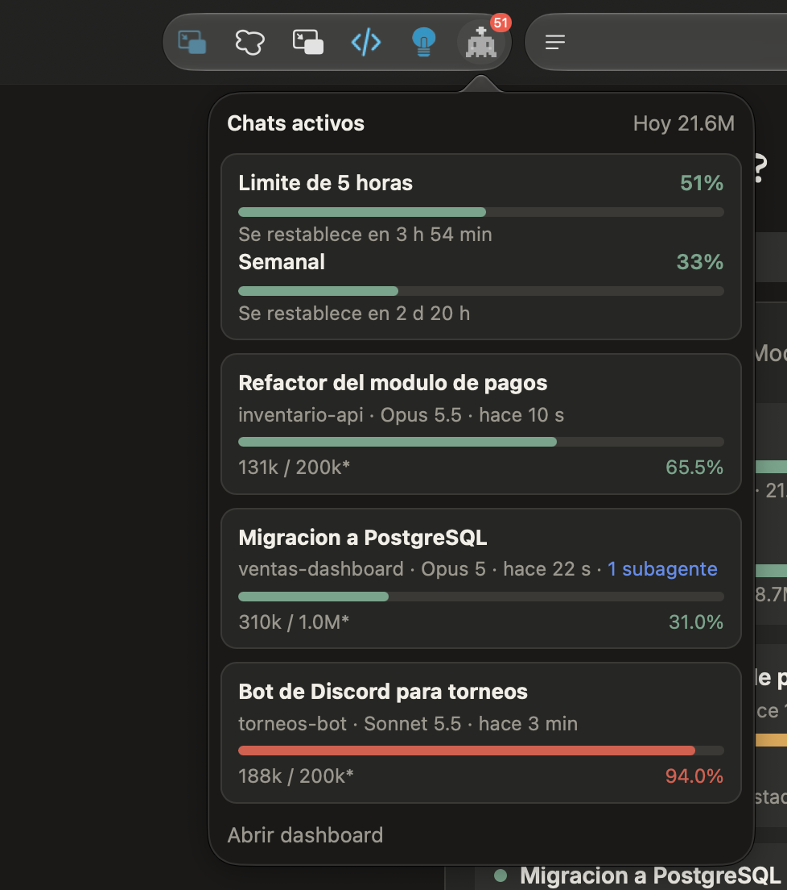

# ClaudeHub para Safari

Extension de Safari que muestra los limites de tu plan y los chats activos de Claude Code. Lee la API local de ClaudeHub (`127.0.0.1:4317`); no envia datos a ningun otro sitio.

- **Insignia** del boton: porcentaje del limite de 5 horas, en verde, ambar o rojo. Se actualiza cada minuto.
- **Popup**: limites de 5 horas y semanal, y cada chat activo con su barra de contexto.

<p align="center"></p>

Captura del modo demo (datos ficticios), probada en Safari con macOS 27 en Apple Silicon.

## Requisitos

- macOS 14 (Sonoma) o superior, con Safari 17 o superior, y Xcode.
- ClaudeHub corriendo: `pnpm tray` o `pnpm start`.
- Puerto 4317 fijo. Con `pnpm demo` el servidor escucha en 4318: para probar la extension con datos ficticios usa `CLAUDEHUB_DEMO=1 PORT=4317 pnpm start`.

## Compilar e instalar

```bash
cd safari
xcodebuild -project ClaudeHub/ClaudeHub.xcodeproj -scheme ClaudeHub -configuration Debug \
  -derivedDataPath build DEVELOPMENT_TEAM=<tu-team-id> -allowProvisioningUpdates build
open build/Build/Products/Debug/ClaudeHub.app
```

Luego, en Safari: **Ajustes > Extensiones**, activa **ClaudeHub** y permite el acceso a `127.0.0.1`. Fija el boton en la barra de herramientas.

Con un perfil gratuito de desarrollo la app caduca a los 7 dias y hay que recompilar. Para probar sin firmar, activa **Desarrollar > Permitir extensiones sin firmar** (se desactiva al cerrar Safari).

## Estructura

- `extension/`: la extension web (Manifest V3, JavaScript sin dependencias). Tambien alimenta las extensiones de Chrome, Edge, Brave y Firefox: ver [`extensions/README.md`](../extensions/README.md).
- `ClaudeHub/`: proyecto de Xcode generado con `xcrun safari-web-extension-converter extension`.

## Servidor

La API solo responde con cabeceras CORS a origenes `safari-web-extension://`, solo en `GET` y solo en `/api/active`. Los demas endpoints no reciben CORS. El servidor sigue escuchando unicamente en `127.0.0.1`.
